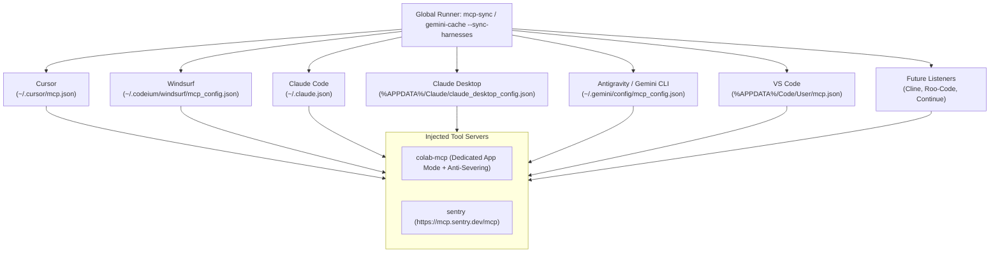

# 🔄 Cross-Harness MCP Synchronization & Sentry Orchestration Engine
**One-Click Synchronization of Model Context Protocol (MCP) Servers Across All AI Coding Platforms**

> [!IMPORTANT]
> **Core Architectural Purpose:**
> Developers operate across multiple AI tools simultaneously (Cursor, Windsurf, Claude Code, Claude Desktop, Antigravity, VS Code, Cline, Roo-Code, Continue).
> 
> Manually editing `mcp.json` or `claude_desktop_config.json` in disparate config directories causes configuration drift, broken paths, and duplicate server processes.
> 
> `mcp-sync` provides an idempotent, automated orchestrator that locates and updates all platform configurations simultaneously, establishing instant zero-friction tool parity.

---

## 1. Supported AI Coding Harness Targets



---

## 2. Configuration Schema & Translation

Different harnesses use slightly different JSON schemas:
- Standard MCP harnesses (Cursor, Windsurf, Claude, Antigravity): Use key `"mcpServers"`.
- VS Code: Uses key `"servers"` and requires a wrapper object with `"type": "stdio"`.

`mcp-sync` applies automatic schema mapping and atomic file backups (`<file>.bak`) before updating:

```python
harness_targets = [
    {"name": "Cursor", "path": "~/.cursor/mcp.json", "key": "mcpServers"},
    {"name": "Windsurf", "path": "~/.codeium/windsurf/mcp_config.json", "key": "mcpServers"},
    {"name": "Claude Code", "path": "~/.claude.json", "key": "mcpServers"},
    {"name": "Claude Desktop", "path": "%APPDATA%/Claude/claude_desktop_config.json", "key": "mcpServers"},
    {"name": "Antigravity", "path": "~/.gemini/config/mcp_config.json", "key": "mcpServers", "extra": {"timeout": 30000}},
    {"name": "VS Code", "path": "%APPDATA%/Code/User/mcp.json", "key": "servers", "wrapper": lambda c: {"type": "stdio", **c}},
]
```

---

## 3. Sentry Integration & Paperclip Peer Rectification

- **Sentry Organization:** `eloquent-6q`
- **Machine-Wide Environment Variables:**
  - `SENTRY_AUTH_TOKEN`: Persisted in Windows User Environment variables.
  - `SENTRY_ORG="eloquent-6q"`: Persisted in Windows User Environment variables.
- **Paperclip Integration:**
  - Peer dependency `@sentry/node@10.71.0` installed in `@paperclipai/server`.
  - Vitest test suite passes 37/37 tests.
  - DSN resolution supports component-specific overrides:
    - `SENTRY_DSN_FRONTEND`: Frontend UI errors.
    - `SENTRY_DSN_BACKEND`: Server and agent execution errors.
    - `SENTRY_DSN`: Universal fallback.

---

## 4. Obsidian Knowledge Graph Connections

- **Related Notes:**
  - [[GLOBAL_KNOWLEDGE_INDEX]] - Master catalog of algorithms, hardware protocols, and systems
  - [[GEMINI_CONTEXT_CACHING]] - Explicit context caching for Aether / MyAssistance
  - [[COLAB_MCP_INTEGRATION]] - Google Colab anti-severing MCP bridge
  - [[VENTURE_INCUBATOR]] - Strategic R&D roadmap
