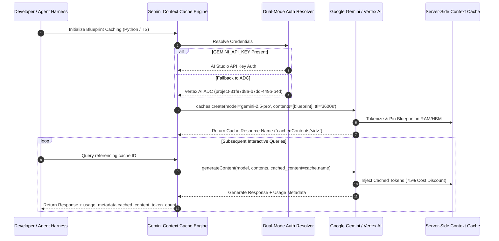

# 🧠 Universal Gemini Explicit Context Caching & Kernel Spec Engine
**High-Throughput Blueprint Caching, 75% Cost Reduction & Dual-Mode Auth (Google AI Studio + Vertex AI ADC)**

> [!IMPORTANT]
> **Core Architectural Purpose:**
> In multi-agent pipelines (such as the MyAssistance control plane and Aether co-pilot), system blueprints, kernel packet processing logic (KPPC), and domain specifications span tens of thousands of tokens.
> 
> Sending these static blueprints on every LLM prompt consumes millions of unnecessary input tokens, increases latency, and risks hitting provider rate limits.
> 
> **Gemini Explicit Context Caching** stores the tokenized representation server-side for a configurable TTL (e.g. 1 hour = 3600s), allowing subsequent queries to reference the cached resource name. This yields an immediate **75% reduction in input token costs** and sub-second prompt evaluation.

---

## 1. High-Level Architecture



---

## 2. Mathematical Foundation & Economics

### 2.1 Token Economics & Discount Curve
Let:
- $N_{\text{blueprint}}$ be the static blueprint token count ($N_{\text{blueprint}} \ge 32,768$).
- $N_{\text{query}, i}$ be the interactive query token count for prompt $i$.
- $k$ be the number of prompts issued within cache lifetime $T_{\text{TTL}}$.
- $C_{\text{base}}$ be the standard input token rate ($\$1.25 / \text{M tokens}$ on Gemini 2.5 Pro).
- $C_{\text{cached}}$ be the discounted cached token rate ($\$0.3125 / \text{M tokens}$, a 75% discount).
- $C_{\text{storage}}$ be the cache holding cost ($\$1.00 / \text{M tokens} / \text{hour}$).

The traditional un-cached total cost $T_{\text{uncached}}$ across $k$ queries is:
$$T_{\text{uncached}} = \sum_{i=1}^{k} \left(N_{\text{blueprint}} + N_{\text{query}, i}\right) C_{\text{base}} = k \cdot N_{\text{blueprint}} \cdot C_{\text{base}} + \sum_{i=1}^k N_{\text{query}, i} \cdot C_{\text{base}}$$

With Explicit Context Caching, the blueprint is billed once for initial ingestion, storage is charged per hour, and every subsequent query enjoys the 75% cached rate:
$$T_{\text{cached}} = N_{\text{blueprint}} \cdot C_{\text{base}} + N_{\text{blueprint}} \cdot C_{\text{storage}} \cdot \left(\frac{T_{\text{TTL}}}{3600\text{ s}}\right) + \sum_{i=1}^{k} \left(N_{\text{blueprint}} \cdot C_{\text{cached}} + N_{\text{query}, i} \cdot C_{\text{base}}\right)$$

### 2.2 Break-Even Threshold ($k^*$)
Solving for $T_{\text{cached}} < T_{\text{uncached}}$:
$$k^* > 1 + \frac{C_{\text{storage}}}{C_{\text{base}} - C_{\text{cached}}} = 1 + \frac{1.00}{1.25 - 0.3125} = 1 + \frac{1.00}{0.9375} \approx 2.067$$

> [!TIP]
> **Economic Break-Even Point:**
> If you make **3 or more queries** against a blueprint within an hour, Explicit Context Caching is strictly cheaper than traditional prompting. At $k = 50$ queries, total input cost drops by **~73.2%**.

---

## 3. Dual-Language Implementation

### 3.1 Python SDK Implementation (`google-genai`)
Located at `C:\Users\Zachariah\tools\gemini_context_cache.py`:

```python
import os
from google import genai
from google.genai import types

def get_genai_client() -> genai.Client:
    """Initializes Google GenAI Client with auto-fallback to Vertex AI ADC."""
    api_key = os.environ.get("GEMINI_API_KEY") or os.environ.get("GOOGLE_API_KEY")
    if api_key:
        return genai.Client(api_key=api_key)
    
    # Automatic fallback to authenticated local Vertex AI ADC
    project = os.environ.get("GOOGLE_CLOUD_PROJECT", "project-31f97d8a-b7dd-449b-b4d")
    location = os.environ.get("GOOGLE_CLOUD_LOCATION", "us-central1")
    return genai.Client(vertexai=True, project=project, location=location)

# 1. Create the Cache
client = get_genai_client()
cache = client.caches.create(
    model="gemini-2.5-pro",
    config=types.CreateCachedContentConfig(
        contents=[blueprint_text],
        system_instruction="You are Aether, the core collaborative co-pilot operating inside the MyAssistance control plane.",
        ttl="3600s",
    ),
)

# 2. Query Referencing Cache
response = client.models.generate_content(
    model="gemini-2.5-pro",
    contents="Analyze the current routing logic in our framework and propose an optimized webhook verification layer.",
    config=types.GenerateContentConfig(
        cached_content=cache.name,
        temperature=0.7,
    ),
)
```

### 3.2 TypeScript / Node.js Implementation (`@google/genai`)
Located at `C:\Users\Zachariah\tools\gemini_context_cache.ts` (runs natively on Node 24):

```typescript
import { GoogleGenAI } from '@google/genai';

export function getAIClient() {
  const apiKey = process.env.GEMINI_API_KEY || process.env.GOOGLE_API_KEY;
  if (apiKey) return new GoogleGenAI({ apiKey });

  return new GoogleGenAI({
    vertexai: true,
    project: process.env.GOOGLE_CLOUD_PROJECT || 'project-31f97d8a-b7dd-449b-b4d',
    location: process.env.GOOGLE_CLOUD_LOCATION || 'us-central1',
  });
}

// 1. Create the Cache
const ai = getAIClient();
const cache = await ai.caches.create({
  model: 'gemini-2.5-pro',
  config: {
    contents: [blueprintContent],
    systemInstruction: 'You are Aether, the core collaborative co-pilot operating inside the MyAssistance control plane.',
    ttl: '3600s',
  },
});

// 2. Query Referencing Cache
const response = await ai.models.generateContent({
  model: 'gemini-2.5-pro',
  contents: 'Analyze the current routing logic in our framework and propose an optimized webhook verification layer.',
  config: {
    cachedContent: cache.name,
  },
});
```

---

## 4. Global CLI Usage

Both engines are registered in `~/.local/bin` and can be invoked from any terminal:

```bash
# Node.js / TypeScript CLI
gemini-cache-node --list-caches
gemini-cache-node --test-cache
gemini-cache-node --sync-harnesses

# Python CLI
gemini-cache --list-caches
gemini-cache --test-cache
gemini-cache --sync-harnesses
```

---

## 5. Obsidian Knowledge Graph Connections

- **Related Notes:**
  - [[GLOBAL_KNOWLEDGE_INDEX]] - Master catalog of algorithms, hardware protocols, and systems
  - [[VENTURE_INCUBATOR]] - Strategic R&D roadmap (Track 9: Universal Context Caching)
  - [[COLAB_MCP_INTEGRATION]] - Google Colab anti-severing MCP bridge
  - [[CROSS_HARNESS_MCP_SYNC]] - Cross-platform AI coding harness orchestrator
  - [[BOUNTY_BOARD]] - Active bounties and completed engineering milestones
  - [[HALL_OF_FAME]] - Antigravity engineering breakthrough inductions
