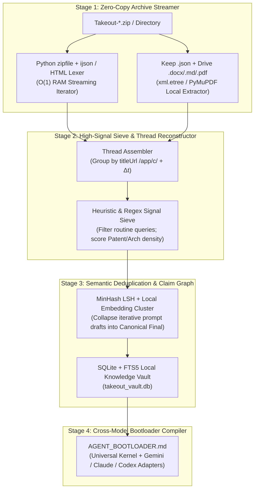
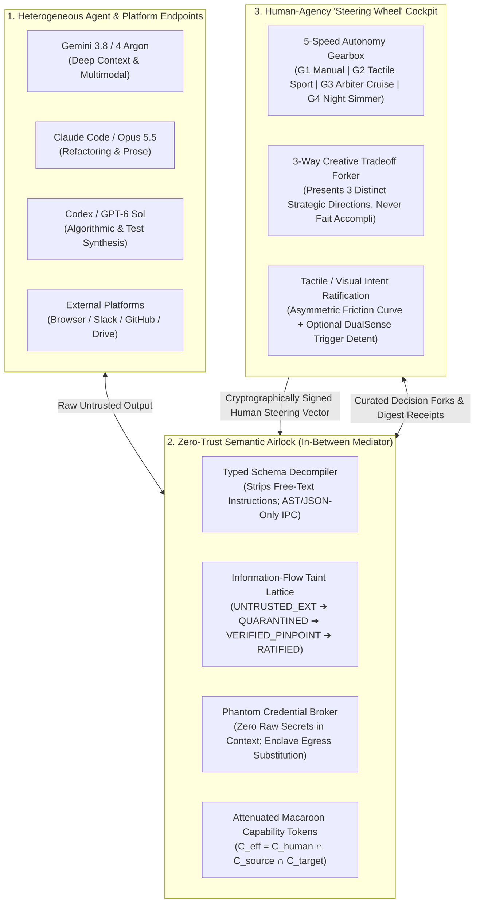

# 🔥 Low & Slow Venture Incubator & Patent/Product Vault
**Strategic R&D Ledger for High-Leverage Human + Multi-AI Products (`Zachariah x Antigravity / Claude / Codex`)**

> [!IMPORTANT]
> **Philosophy ("All Good Things Take Time"):**
> This vault is where we simmer, stress-test, and refine novel, defensible, revenue-generating software and hardware-bridge architectures. Rather than generic wrapper apps, every concept here focuses on **hard technical moats**—low-level systems integration, multi-agent cross-verification (Gemini + Claude + Codex), real-time telemetry/physics bridges, enterprise/creator live-ops, and patentable workflows.

---

## 🥩 Track 1: Enterprise & Creator Omni-Stream Chat Aggregator, Fair-Share Community Router & Sponsor Deck ("OmniChorus" / "PulseDeck")

### 1. Competitive Landscape & Why Existing Tools Fail (The High-Margin Dual Wedge)

| Tool / Platform | Segment | Core Strengths | Architectural & Commercial Failure Modes |
| :--- | :--- | :--- | :--- |
| **SocialStream.ninja** | Open-Source Creator | Free (GPLv3), supports 20+ platforms via DOM scraping/WebSockets, local OBS overlays. | **Fragile DOM Scraping & Chronological Firehose:** Breaks when YouTube/TikTok/X change web DOM classes; dumps messages chronologically without cross-platform velocity normalization; lacks structured enterprise Q&A or sponsor ROI reporting. |
| **Restream Chat** | Cloud Simulcast | Clean unified cloud dashboard, Cross-Platform Relay mode, basic word filters. | **Ecosystem Lock-in & Zero Attention Routing:** Strictly chronological feed where high-volume platforms drown out smaller rooms; no mod-to-presenter teleprompter or cross-platform gift normalization. |
| **Casterlabs Caffeinated** | Creator Desktop | Native 7TV/BTTV/FFZ emotes, Java plugin SDK, free desktop app. | **API Quota Delays & Polling Bottlenecks:** YouTube polling delays (up to ~5 min lag on stream start), TikTok connection drops and ~10% quality-filter message loss; basic moderation with no mod-backchannel. |
| **StreamElements / Tangia / Blerp** | Monetization / Alerts / TTS | High-engagement soundboards (Blerp), AI voice clones/interactions (Tangia), brand marketplace (SE). | **Siloed Monetization & Audio Collisions:** No unified multi-currency gift ledger across Twitch/YouTube/TikTok/Kick; TTS talks right over presenter speech (no VAD ducking); zero cross-platform sponsor attribution reports. |
| **Slido / Pigeonhole Live** | Enterprise Town Halls | SSO/SCIM (Okta/Azure AD), Teams/Webex/Zoom sidebars, structured Q&A upvoting. | **Destination Silo (Audience Must Leave the Stream):** Requires attendees to scan a QR code or use a separate web portal rather than ingesting native chat from LinkedIn Live, YouTube, Slack, Teams, and Zoom simultaneously; expensive annual enterprise lock-in (\$5k–\$25k+/yr). |

#### The Dual Revenue Wedge:
1. **The "Firehose Drowning" Problem (Creator & Enterprise):** When a creator simulcasts to 5,000 viewers on YouTube, 800 on Twitch, 150 on Kick, and 90 on Discord—or an enterprise CEO hosts a Town Hall with 4,000 employees on Teams, 300 on Zoom, and 80 executives in a Slack channel—chronological aggregators give **93%+ of screen real estate** to the largest room. Smaller communities feel ignored and churn.
2. **Missing Mod-to-Presenter Cockpit:** High-tier streamers and C-suite speakers cannot read a 50 msg/sec scroll while speaking. They need a **Mod-Curated Teleprompter HUD** where moderators apply heavy modifiers, cluster duplicate questions, and whisper live context.
3. **High-Margin Sponsor Proof-of-Performance:** Agencies paying \$5,000–\$50,000 for a multi-platform sponsored segment currently rely on manual VOD screenshots. Automating synchronized multi-chat CTA link drops, live sponsor-keyword elevation, and a **1-Click Cryptographically Timestamped PDF/HTML Sponsor ROI Report** creates an immediate B2B/Agency SaaS wedge (\$99–\$499/mo Creator Pro/Agency, \$2,500+/mo Enterprise).

---

### 2. Sub-Linear Deficit Weighted Fair-Queuing (DWFQ) & Heavy Modifier Architecture

#### A. Platform Virtual Time & Inverse-Velocity Weighting
Let $P = \{p_1, p_2, \dots, p_k\}$ be the set of active platforms/threads, and let $\lambda_p(t)$ be the exponentially smoothed message arrival rate (msgs/sec) on platform $p$ over a sliding window $\tau = 10\text{ s}$:
$$\lambda_p(t) = \alpha \cdot r_p(t) + (1 - \alpha)\lambda_p(t - \Delta t), \quad \alpha = 0.2$$

Instead of equal per-message probability (which lets high-$\lambda_p$ platforms drown out smaller rooms) or naive round-robin (which over-represents a single spammer in an empty room), each platform $p$ is assigned a **Sub-Linear Fair-Share Bandwidth Weight** $W_p$:
$$W_p = \max\left(W_{\min},\; \frac{(\lambda_p + \epsilon)^\beta}{\sum_{j \in P} (\lambda_j + \epsilon)^\beta}\right), \quad \beta \in [0.25, 0.40]$$
- **Concrete Example ($\beta = 0.30$):**
  - Suppose **YouTube** runs at $\lambda = 25.0\text{ msg/s}$, **TikTok** at $\lambda = 1.5\text{ msg/s}$, and **Discord** at $\lambda = 0.3\text{ msg/s}$.
  - A chronological firehose gives **93.2% YouTube / 5.6% TikTok / 1.1% Discord**.
  - Under $\beta = 0.30$ DWFQ, the presenter HUD attention budget becomes **54.1% YouTube / 23.3% TikTok / 14.4% Discord / 8.2% Kick**, guaranteeing that every community corner gets genuine love and visibility!

#### B. Message Priority Score & Heavy Presenter/Mod Modifiers
Within each platform queue $Q_p$, each incoming message $m_i$ receives a composite utility score $U(m_i)$:
$$U(m_i) = B_{\text{base}} \cdot M_{\text{affinity}}(u_i) \cdot M_{\text{semantic}}(m_i) + \Omega_{\text{mod}}(m_i) + \Omega_{\text{sponsor}}(m_i)$$

1. **Community Affinity Multiplier $M_{\text{affinity}}(u_i)$:**
   - **First-Time Chatter Boost:** $+2.5\times$ (tagged with `[🌱 FIRST CHAT on <Platform>]` so the presenter can welcome new family members).
   - **Streak / Loyal Supporter / VIP / Sub Tier:** $+1.5\times \text{ to } +3.0\times$ across linked cross-platform identities.
2. **Semantic Question Clustering $M_{\text{semantic}}(m_i)$:**
   - Uses a local quantized embedding model (`all-MiniLM-L6-v2` via ONNX Runtime) over a 120-second ring buffer (cosine similarity $\theta \ge 0.82$).
   - Collapses duplicate questions across platforms into a single **Representative Cluster Card** with a live multi-platform badge counter:
     `[🔥 14x ASKED | YT: 9, Twitch: 3, Discord: 2] "When does the new build drop?"` and boosts priority by $1 + \ln(1 + N)$.
3. **Mod-Team Backchannel Override $\Omega_{\text{mod}}(m_i)$:**
   - **`MOD_PIN_HUD` ($\Omega = +\infty$):** Pins directly to the top of the Presenter Teleprompter Deck with an inline Mod Whisper note (`[🛡️ Mod Sarah: Answered in patch v1.4 — tell them Friday]`).
   - **1-Click Global Mode Modifiers (Hotkeys / StreamDeck):**
     - `MODE_FAMILY_LOVE`: $\beta = 0.25$, maximizes cross-platform diversity and first-time chatter boosts.
     - `MODE_QA_CLUSTER`: Surfaces only semantically clustered questions and upvoted queries.
     - `MODE_SPONSOR_BLOCK`: Activates $\Omega_{\text{sponsor}}$ boost (+500 pts) for campaign keywords (`!promo`, brand name, product questions) while triggering synchronized multi-chat CTA links.

---

### 3. Universal Multi-Currency & Platform Gift Normalizer + VAD-Ducked Neural TTS

#### A. Platform-Specific Conversion Matrix
| Platform & Event Type | Raw Payload Fields | Normalization Formula to `gross_usd` | Faithful HUD & TTS Attribution Format |
| :--- | :--- | :--- | :--- |
| **YouTube Live** (`superChatEvent` / `superStickerEvent`) | `snippet.superChatDetails.amountMicros`, `currency` (40+ ISO-4217 codes: `JPY`, `EUR`, `GBP`, `BRL`, `INR`, `KRW`, `AUD`, `CAD`, `MXN`, etc.) | $\text{USD} = \frac{\text{amountMicros}}{10^6} \times \text{FX}_{\text{ISO}\to\text{USD}}$ | **HUD:** `[YT] @Takumi • ¥5,000 (\$33.50)` **TTS:** *"Shoutout to Takumi on YouTube Live for the ¥5,000 SuperChat (~\$33.50)!"* |
| **Twitch EventSub** (`channel.cheer`, `channel.subscribe`, `channel.subscription.gift`) | `event.bits` (int), `event.tier` (`"1000"`, `"2000"`, `"3000"`), `event.total` (gift count) | $\text{Bits}: \text{bits} \times \$0.01$ $\text{Sub Tier } 1/2/3: \$4.99 / \$9.99 / \$24.99 \times \text{regional\_factor}$ | **HUD:** `[TW] @NightOwl • 1,500 Bits (\$15.00)` **TTS:** *"Big love to NightOwl on Twitch for cheering 1,500 Bits (\$15.00)!"* |
| **TikTok Live** (`WebcastGiftMessage` Protobuf) | `giftId`, `giftDetails.diamondCount`, `repeatCount`, `repeatEnd` (waits for `repeatEnd == 1` on streakable gifts) | $\text{Coins} = \text{diamondCount} \times \text{repeatCount}$ $\text{Gross USD} \approx \text{Coins} \times \$0.0106$ | **HUD:** `[TT] @Valkyrie • 🦁 Lion Gift (29,999 Coins / ~\$318)` **TTS:** *"Massive shoutout to Valkyrie on TikTok Live for dropping a Lion Gift (~\$318)!"* |
| **Kick** (`ChatroomSub` / `GiftedSubscriptionsEvent` / `Kicks`) | `gifted_usernames[]`, `sub_tier` | $\text{Sub} = \$4.99 \times \text{count}$ | **HUD:** `[KICK] @ApexRacer • 5x Gifted Subs (\$24.95)` **TTS:** *"Shoutout to ApexRacer on Kick for gifting 5 subs to the community!"* |
| **Enterprise / Charity** (Stripe / Tiltify / Fourthwall Webhook) | `amount_cents`, `currency`, `donor_company` | $\frac{\text{amount\_cents}}{100} \times \text{FX}_{\text{ISO}\to\text{USD}}$ | **HUD:** `[CHARITY] @AcmeCorp • €500.00 (\$542.00)` **TTS:** *"Thank you to AcmeCorp for the €500 charity pledge (~\$542)!"* |

#### B. Low-Latency Neural TTS Queue with Presenter Voice-Activity Ducking (VAD)
1. **Local / Hybrid Neural Synthesis:** Uses ultra-low-latency local neural TTS (**Kokoro-82M** or **Piper ONNX** running in `<45ms` locally, with optional **ElevenLabs Flash v2.5** fallback) to synthesize `[Attribution Header] + [250ms Chime/Pause] + [Chatter Message]`.
2. **Real-Time Presenter Sidechain VAD & Smart Hold:**
   - Monitors the presenter's microphone input bus via Silero VAD + RMS envelope detector (`T_attack = 5ms`, `T_release = 450ms`).
   - **Pre-Speech Gate:** If the presenter is actively speaking (`VAD_prob > 0.65`), the TTS queue holds the next announcement at the head of the queue until the presenter pauses for $\ge 600\text{ ms}$.
   - **Mid-Speech Sidechain Ducking:** If the presenter starts talking while a TTS message is playing, the TTS bus smoothly ducks by **$-14\text{ dB}$** over a $50\text{ ms}$ cosine ramp (or pauses at the next clause boundary and resumes cleanly after).

---

## 🧬 Track 2: Google Takeout + Patent "Bootloader / Instantiator" Synthesis Pipeline

### 1. Exact Google Takeout Archive Schemas (`MyActivity.json` / `.html`, Keep, Drive)
- **Gemini Apps Activity (`Takeout/My Activity/Gemini Apps/MyActivity.json` or `.html`):**
  - Contains `title` (`"Prompted <user_prompt>"`), `titleUrl` (`"https://gemini.google.com/app/c/<conversation_id>"`), ISO-8601 `time`, `subtitles` (attached files), and `safeHtmlItem[].html` (the full model response).
  - Multi-turn threads are reconstructed by grouping records on the `/app/c/<conversation_id>` suffix from `titleUrl` (or clustering contiguous timestamps within $\Delta t < 45\text{ min}$) and sorting ascending by `time`.
- **Google Keep (`Takeout/Keep/<Note>.json`):**
  - Contains `title`, `textContent`, `listContent[]`, `labels[]`, `isPinned`, and microsecond timestamps (`createdTimestampUsec`, `userEditedTimestampUsec`).
- **Google Drive / Docs (`Takeout/Drive/`):**
  - Contains `.docx` (`word/document.xml`), `.md`, `.pdf`, `.txt`, and `-metadata.json` sidecars.

### 2. Zero-Cloud O(1)-RAM Streaming Parser Architecture (`takeout_bootloader_ingest.py`)

- **Signal Density Scoring $S(d)$:**
  $$S(d) = w_1 \cdot \text{Count}(\text{PatentLexicon}) + w_2 \cdot \text{Count}(\text{ArchPrimitives}) + w_3 \cdot \mathbb{I}(\text{HasCodeOrMath}) + w_4 \cdot \ln(\text{TurnDepth})$$
- **Iterative Draft Collapse:** Uses 128-permutation MinHash LSH (Jaccard $\ge 0.70$) within each conversation thread to chain evolving drafts of your patent claims and bootloader prompts, promoting the **latest terminal revision** as canonical while preserving the conception-date timestamp chain!

---

## 🎮 Track 3: Universal DirectInput/XInput/HID Telemetry & Haptic Middleware ("SimBridge")
- **Proven in `vibrant-darwin`:** Solves `DINPUT8.dll` + `XInput` dual-enumeration (`DeviceIndex="4"` ghost hijacking via PE IAT hook), deadzone-crushed gamepad curves, and adds native DualSense 6-axis gyro + adaptive triggers to 250+ classic and indie PC sims.

---

## ⚖️ Track 4: Cross-Model "Arbiter Forge" (Gemini + Claude + Codex Consensus & PINPOINT Gatekeeper)
- **Proven in `vibrant-darwin` + `local-forge`:** Multi-AI development harness where Gemini, Claude, and Codex claim bounties on a local Gitea instance, red-team each other's diffs, and are blocked from merging until deterministic compiled `PINPOINT` checks and SHA256 parity pass 100%.

---

## 🛡️ Track 5: Sovereign In-Between Mediator & "Steering-Wheel" Human-Agency Harness ("NexusHelm" / "Interlock")

### 1. The Dual Wedge: Why "Seamless" Multi-Agent Systems Fail Today
Multi-agent control planes (including Paperclip, AutoGen, and CrewAI) currently fail when deployed across heterogeneous platforms and frontier models (Gemini + Claude + Codex) due to two opposing barriers:

1. **Hurdle A (Severe Cross-Platform Security Risks):**
   - Natural language relays between models create immediate indirect prompt injection vectors (an untrusted web/code summary fed from Agent A into Agent B executes with host privileges).
   - Insecure defaults (`dangerouslySkipPermissions: true`, `--sandbox=none`) turn multi-agent collaboration into an unmonitored attack surface.
   - Shared `.env` files and environment variables leak Provider A's API credentials to Provider B's telemetry.
2. **Hurdle B (Human-Agency Pushback & "Passenger-Seat Alienation"):**
   - When agents pass tasks back and forth autonomously, the human is relegated to either a rubber-stamping compliance clerk (50 approval popups/hour causing modal fatigue) or an alienated spectator terrified of a silent 2,000-line rogue refactor.
   - Users resist automation not because they hate speed, but because they **lose creative ownership and directional control**.

---

### 2. Solving Hurdle A: Three Cryptographic & Information-Flow Security Invariants

1. **Zero-Natural-Language Inter-Agent Airlock ("Typed Semantic IPC")**:
   - Models on different platforms never exchange unconstrained conversational prose as executable commands.
   - Every cross-model payload is decompiled by the mediator into a strictly typed semantic envelope:
     $$\text{Envelope} = \langle \text{ActionID} \in \mathcal{A}_{\text{allowlist}},\; \text{TypedParams} \in \mathcal{S}_{\text{json}},\; \text{UntrustedBlob}_{\text{quarantined}} \rangle$$
   - The receiving agent adapter treats `UntrustedBlob` as inert data, strictly forbidding tool invocation based on instructions found within the payload.
2. **Monotonic Information-Flow Taint Lattice**:
   - Taint levels adhere to a strict ordering:
     $$\text{HUMAN\_ROOT} > \text{PINPOINT\_VERIFIED} > \text{INTERNAL\_AGENT} > \text{EXTERNAL\_UNTRUSTED}$$
   - Any data derived from external or lower-trust sources automatically degrades output trust:
     $$T_{\text{out}} = \min(T_{\text{in}},\; T_{\text{source}})$$
   - Capability attenuation function $\Phi(T)$ unconditionally strips dangerous capabilities (`shell_exec_unconfined`, `git_push`, `network_egress`) until a deterministic test suite or human ratification gate promotes the artifact.
3. **Phantom Secret Broker (Zero-Knowledge Credential Substitution)**:
   - Real API keys and credentials never enter agent memory, prompts, or workspace files.
   - The mediator provisions short-lived, HMAC-signed phantom handles (`phantom://v1/<run_id>/<cap_hash>`).
   - Outbound requests routed through the local proxy swap phantom handles for live tokens over TLS, making cross-model credential harvesting impossible.

---

### 3. Solving Hurdle B: "Steering-Wheel" Human Agency Architecture

Inspired by the tactile physics of `vibrant-darwin` (where power steering amplifies intent without disconnecting the driver from the road):

1. **The 5-Speed "Autonomy Gearbox"**:
   - **Gear 1 (`MANUAL_CLUTCH`)**: Full step-by-step human confirmation on every cross-model handoff.
   - **Gear 2 (`SPORT_TACTILE`)**: Autonomous research and read operations; code modifications and file writes pause for interactive visual diff review.
   - **Gear 3 (`ARBITER_CRUISE`)**: Cross-model consensus (e.g. Gemini + Claude agree AND 100% of deterministic PINPOINT tests pass) auto-commits locally; only external side effects (push, deploy, spend) require human sign-off.
   - **Gear 4 (`LOW_AND_SLOW_SIMMER`)**: Background overnight budget-harvesting mode operating within an isolated branch, synthesizing the morning **Executive Briefing / Dailies Deck**.
   - **Neutral / E-Brake (`TOUCHPAD_CLICK / ESC`)**: Instant atomic halt of all active runner processes.
2. **Mandatory "Rule of 3" Creative Forking (Anti-Fait-Accompli Invariant)**:
   - When facing architectural, product, or design tradeoffs, the mediator is strictly forbidden from silently making the choice and presenting a finished monolith.
   - Instead, it must distill the cross-model debate into a **3-Way Steering Fork** with clear tradeoff criteria:
     - **Path A (Speed & Minimal Blast Radius)**
     - **Path B (Balanced Production Architecture)**
     - **Path C (High-Moat Patent / Long-Horizon Wedge)**
   - The human makes the selection or blends paths, preserving 100% creative authorship.
3. **Asymmetric Agency Friction & DualSense Haptic Ratification**:
   - Friction scales with Blast Radius Score $B(a) \in [0, 100]$:
     - $B(a) < 20$ (Read/scratchpad): Zero friction, passive telemetry display.
     - $20 \le B(a) < 70$ (Local branch edit): Soft friction, confirmed via 1-click keyboard tap or soft DualSense R2 pull.
     - $B(a) \ge 70$ (Spend, deploy, external mutation): Hard detent (`TriggerMode=0x21` resistance + `0x26` 40 Hz pulse), requiring deliberate physical pull or typed signature.

---

## ✈️ Track 6: "CROSSWIND: GROUND EFFECT" — Atmospheric Flight Survival & Tactile MudRunner Simulation

### 1. Commercial Wedge & Market Failure Mode (\$19.99 Steam Sweet Spot)
- **Market Vacuum:** Traditional flight simulators (MSFS, X-Plane) suffer from the "Cruise Boredom Problem"—95% of gameplay is straight-level autopilot flight. Mobile landing games are shallow 2D arcade toys.
- **The Solution:** *CROSSWIND* isolates aviation's most adrenaline-soaked 15–20 minutes into an intense tactical co-op physics survival experience: high-gross short-field takeoff, mountain blizzard gauntlet, in-flight malfunctions, and extreme ground-effect flare into howling crosswinds.
- **Commercial Appeal:** Viral clip economy (spectacular ground-loop blowouts vs. buttery smooth grease touchdowns), 4–8 player emergency evacuation contracts, and scratchy VHF VOIP radio.

### 2. Core Aerodynamic & Hardware Moats
1. **Sectional Blade Element Theory (BET) & Ground Effect:**
   - Discretized wing stations calculating local $C_L(\alpha_i)$ and $C_D(\alpha_i)$, modeling authentic asymmetric stall autorotation.
   - Dynamic Ground Effect model:
     $$\sigma\left(\frac{h}{b}\right) = \frac{16 (h/b)^2}{1 + 16 (h/b)^2}$$
     Reduces induced drag by up to 86% in the flare, causing aircraft to float unexpectedly on an air cushion.
2. **Crosswind Crab-and-Decrab Kinematics:**
   - Real-time sideslip angle $\beta = \arcsin(v_{\text{crosswind}} / v_{\text{TAS}})$ requiring aggressive rudder kicks at 10 ft AGL. Sideload threshold ($> 7.5^\circ$) triggers realistic tire blowout.
3. **DualSense Dynamic Pressure ($q$) Yoke Stiffening & Buffet:**
   - Adaptive triggers stiffen quadratically with indicated airspeed ($q = \frac{1}{2}\rho v^2$, Mode `0x21`).
   - 32 Hz motor vibration buffets the controller when approaching critical angle-of-attack ($\alpha \ge 14.5^\circ$, Mode `0x26`).

### 3. Verified Working Prototype (`c:\Users\Zachariah\aether agent\crosswind\`)
- **Systems Specification:** [`SPECIFICATION.md`](file:///c:/Users/Zachariah/aether%20agent/crosswind/SPECIFICATION.md)
- **Flight Physics Model:** [`physics.py`](file:///c:/Users/Zachariah/aether%20agent/crosswind/physics.py) (100% pass on 5 unit tests)
- **Mission Runner:** [`mission_runner.py`](file:///c:/Users/Zachariah/aether%20agent/crosswind/mission_runner.py) (Simulates Mission Bravo-6 blizzard approach with engine failure, microburst windshear, and 10,382 pt touchdown)
- **Hardware Profile:** [`dualsense_profile.ini`](file:///c:/Users/Zachariah/aether%20agent/crosswind/dualsense_profile.ini)
