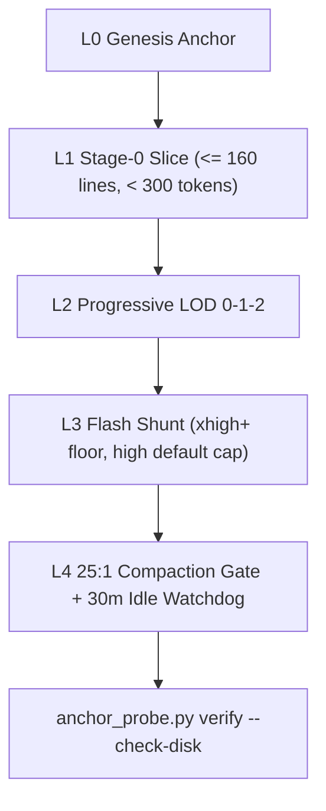

# permanent-skill-tree-anchor

**Deterministic 5-Layer Carbon Orchestration anchor, model-tier floor verifier (`gemini-4-hydrogen-xhigh+`), and cross-runtime SHA-256 skill parity engine for AI coding agents.**

Prompt rules decay over long conversations when silently downgraded models, missing symlinks/junctions, or undocumented state edits creep in. **`permanent-skill-tree-anchor`** turns operational directives into machine-checkable invariants backed by [`scripts/anchor_probe.py`](scripts/anchor_probe.py).

---

## Architecture



---

## Installation

### `skills` CLI
```bash
npx skills add mjeanhudson-dev/permanent-skill-tree-anchor
```

### Cross-Runtime Symlink / Junction Install
```bash
git clone https://github.com/mjeanhudson-dev/permanent-skill-tree-anchor.git ~/.config/agent-skills/permanent-skill-tree-anchor
ln -s ~/.config/agent-skills/permanent-skill-tree-anchor ~/.claude/skills/permanent-skill-tree-anchor
ln -s ~/.config/agent-skills/permanent-skill-tree-anchor ~/.codex/skills/permanent-skill-tree-anchor
ln -s ~/.config/agent-skills/permanent-skill-tree-anchor ~/.gemini/skills/permanent-skill-tree-anchor
```

**Requirements:** Python 3.10+ standard library only (zero required pip dependencies; optional `PyYAML` auto-detected for frontmatter parsing).

---

## Quick Start (`PYTHONDONTWRITEBYTECODE=1`)

```bash
# Run all 8 Popperian positive & fault-injection self-tests
PYTHONDONTWRITEBYTECODE=1 python -B scripts/anchor_probe.py --selftest

# Verify example anchor state invariants
python -B scripts/anchor_probe.py verify --state examples/anchor_state.example.json

# Initialize a local anchor_state.json and verify disk + junction parity
python -B scripts/anchor_probe.py init --out anchor_state.json
python -B scripts/anchor_probe.py verify --state anchor_state.json --check-disk
```

---

## 8 Popperian Self-Test Cases

| # | Case ID | What It Proves |
| :---: | :--- | :--- |
| 1 | `01_valid_anchor_state` | Clean v5 anchor + disk SHA-256 + link parity passes (`exit 0`) |
| 2 | `02_flash_shunt_disabled_rejected` | Disabling `flash_shunt_engaged` fails closed (`exit 2`) |
| 3 | `03_sub_xhigh_floor_rejected` | Lowering `minimum_floor` below `gemini-4-hydrogen-xhigh` fails closed |
| 4 | `04_missing_disallowed_tier_rejected` | Omitting disallowed Flash/Lite tiers fails closed |
| 5 | `05_skill_sha256_drift_detected` | Detects modified `SKILL.md` SHA-256 hash mismatch |
| 6 | `06_broken_junction_detected` | Detects dangling cross-runtime symlinks / NTFS junctions |
| 7 | `07_bom_or_crlf_skill_rejected` | Rejects UTF-8 BOM or CRLF line endings in skill files |
| 8 | `08_os_username_leak_in_public_example_rejected` | Rejects hardcoded local OS user paths in public artifacts |

---

## License

MIT License. Copyright (c) 2026 **Eloquent (`@mjeanhudson-dev`)**. See [LICENSE](LICENSE).
