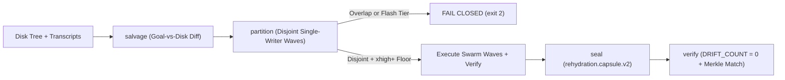

# swarm-salvage-re-coalescence

**Deterministic Stage-0 swarm salvage, goal-vs-disk diffing, single-writer tree partitioning, and cryptographic SHA-256 re-coalescence for AI coding agents.**

Long-running multi-agent swarms stall or crash partway through execution: early builders often ship real code to disk while downstream polish workers stall right *after* diagnosing valuable bugs inside JSONL transcripts. Restarting blindly either overwrites working code or loses recovered findings. **`swarm-salvage-re-coalescence`** solves both mechanically with a zero-dependency Python engine ([`scripts/salvage_re_coalesce.py`](scripts/salvage_re_coalesce.py)).

---

## Workflow



---

## Installation

### `skills` CLI
```bash
npx skills add mjeanhudson-dev/swarm-salvage-re-coalescence
```

### Cross-Runtime Symlink / Junction Install
```bash
git clone https://github.com/mjeanhudson-dev/swarm-salvage-re-coalescence.git ~/.config/agent-skills/swarm-salvage-re-coalescence
ln -s ~/.config/agent-skills/swarm-salvage-re-coalescence ~/.claude/skills/swarm-salvage-re-coalescence
ln -s ~/.config/agent-skills/swarm-salvage-re-coalescence ~/.codex/skills/swarm-salvage-re-coalescence
ln -s ~/.config/agent-skills/swarm-salvage-re-coalescence ~/.gemini/skills/swarm-salvage-re-coalescence
```

**Requirements:** Python 3.10+ standard library only (zero third-party pip packages required; `PyYAML` is optional and auto-detected when installed).

---

## CLI Usage (`PYTHONDONTWRITEBYTECODE=1`)

```bash
# 1. Run all 10 Popperian positive & fault-injection self-tests
PYTHONDONTWRITEBYTECODE=1 python -B scripts/salvage_re_coalesce.py --selftest

# 2. Classify disk deliverables and unapplied transcript audits
python -B scripts/salvage_re_coalesce.py salvage --spec examples/salvage_spec.example.json --out salvage_report.json

# 3. Enforce single-writer path disjointness & model floor (fails closed exit 2 on violations)
python -B scripts/salvage_re_coalesce.py partition --report salvage_report.json --roster examples/roster.example.json --out plan.json

# 4. Seal SHA-256 digests + Merkle root and verify zero drift
python -B scripts/salvage_re_coalesce.py seal --root . --out REHYDRATION_CAPSULE.json --name swarm-salvage-re-coalescence
python -B scripts/salvage_re_coalesce.py verify --capsule REHYDRATION_CAPSULE.json --root .
```

---

## 10 Popperian Self-Test Cases

| # | Case ID | What It Proves |
| :---: | :--- | :--- |
| 1 | `01_clean_salvage_diff` | Verifies clean target classifies as `LANDED_VERIFIED` |
| 2 | `02_transcript_unapplied_audit_recovery` | Recovers unapplied worker findings as `SALVAGED_UNAPPLIED_AUDIT` |
| 3 | `03_writer_collision_rejected` | Rejects overlapping `owned_paths` across authors (`exit 2`) |
| 4 | `04_disallowed_or_missing_model_rejected` | Rejects Flash/Lite or omitted models (`exit 2`) |
| 5 | `05_bom_crlf_hygiene_scan` | Flags UTF-8 BOM (`0xEFBBBF`) and CRLF line endings |
| 6 | `06_os_path_leak_rejected` | Flags hardcoded local OS user paths in text files |
| 7 | `07_seal_and_verify_zero_drift` | Seals SHA-256 digests + Merkle root and verifies `drift_count == 0` |
| 8 | `08_mutated_file_drift_detected` | Catches mutated workspace files immediately (`exit 2`) |
| 9 | `09_merkle_tamper_rejected` | Rejects tampered `merkle_root` even when file bytes match |
| 10 | `10_topological_wave_order` | Orders multi-wave dependencies cleanly from `depends_on` edges |

---

## License

MIT License. Copyright (c) 2026 **Eloquent (`@mjeanhudson-dev`)**. See [LICENSE](LICENSE).
